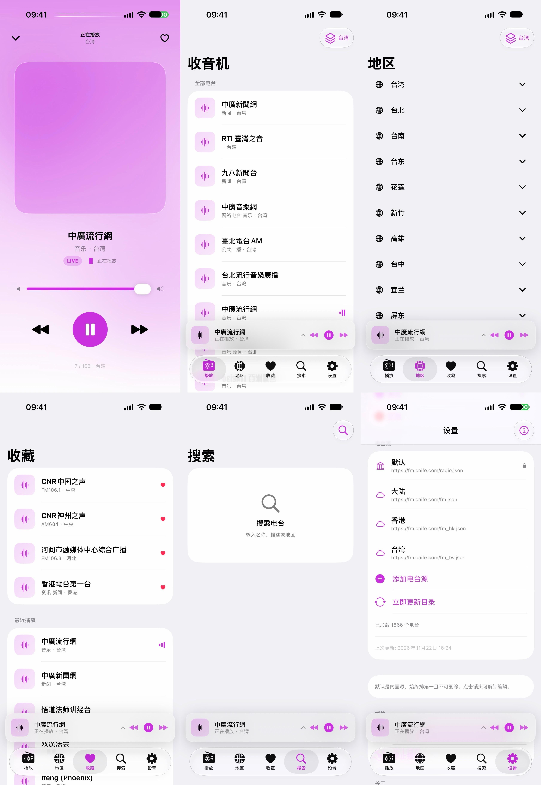

# FmRadio

一个可配置的 iOS 网络收音机项目，使用 SwiftUI 构建，支持电台源配置、按地区浏览、搜索、收藏、后台播放和播放控制。

## 界面预览



## 功能特性

- 远程 JSON 电台源配置
- 内置源与自定义第三方源
- 按地区浏览电台
- 搜索、收藏
- 后台音频播放
- 控制中心 / 锁屏界面的播放与上一首 / 下一首控制
- 主题色与深色模式
- iOS 14 兼容，并在较新系统上提供增强视觉效果

## 技术栈

- Swift 5
- SwiftUI
- AVFoundation / AVPlayer
- UIKit
- Xcode 工程，无外部包依赖

## 目录结构建议

```text
FmRadio/
  FMRadio.xcodeproj/
  Sources/            # Swift 源码
  Resources/          # 图片、资源文件
  Info.plist
.github/
  workflows/
    build.yml         # GitHub Actions 构建 IPA
```

## 快速开始

1. 使用 Xcode 打开 `FMRadio/FMRadio.xcodeproj`。
2. 选择 `FMRadio` scheme。
3. 选择 iOS 真机目标或使用通用 iOS 设备构建。
4. 项目默认关闭代码签名，构建产物为 ad-hoc / unsigned IPA。

## GitHub Actions 自动构建

仓库包含 `.github/workflows/build.yml`：

- 推送到 `main` 分支时自动构建并上传 IPA artifact。
- 手动触发时也会构建并上传 artifact。
- 推送 `v*` 标签时，除上传 artifact 外，还会创建 GitHub Release 并把 IPA 附加到 Release。
- 产物文件名会随版本变化，例如：`FmRadio-1.0.1.ipa`。

构建流程会执行：

- `xcodebuild` 构建 Release-iphoneos
- ad-hoc 签名
- 打包 IPA
- 校验 ZIP 结构、签名、Bundle ID、版本号和最低系统版本

## 电台数据源

应用从配置的 JSON 地址读取电台列表。推荐结构：

```json
{
  "radio": [
    {
      "name": "示例电台",
      "desc": "news",
      "region": "北京",
      "url": "https://example.com/stream.mp3",
      "img_url": "",
      "radio_id": "example-001"
    }
  ]
}
```

字段建议：

| 字段 | 类型 | 说明 |
| --- | --- | --- |
| `name` | String | 电台名称 |
| `desc` | String | 分类或描述 |
| `region` | String | 地区 |
| `url` | String | 音频流地址，建议 HTTPS |
| `img_url` | String | 可选封面地址 |
| `radio_id` | String | 稳定唯一 ID |

## 播放能力说明

播放使用系统 AVPlayer。控制中心与锁屏界面会展示当前电台，并支持播放 / 暂停、上一首、下一首。播放队列会跟随当前选择的电台源变化。

## 许可证

可根据实际需要选择许可证。未声明许可证时，默认仅保留作者权利。
